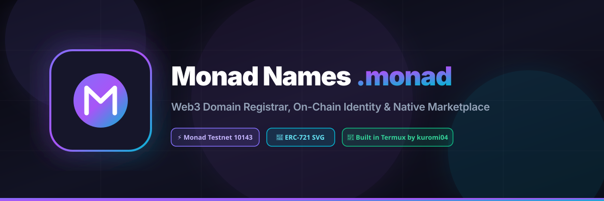
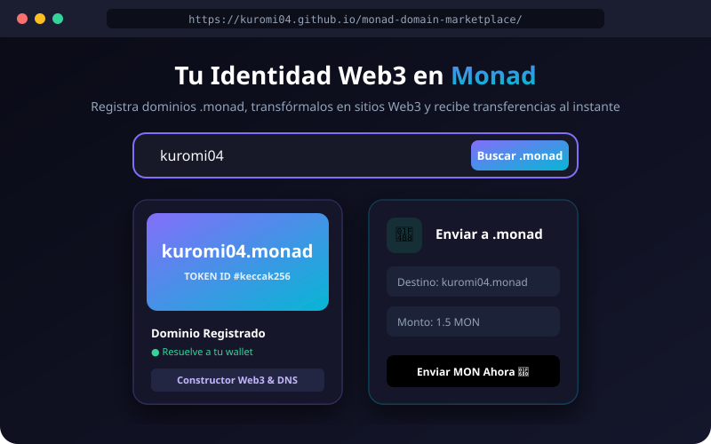
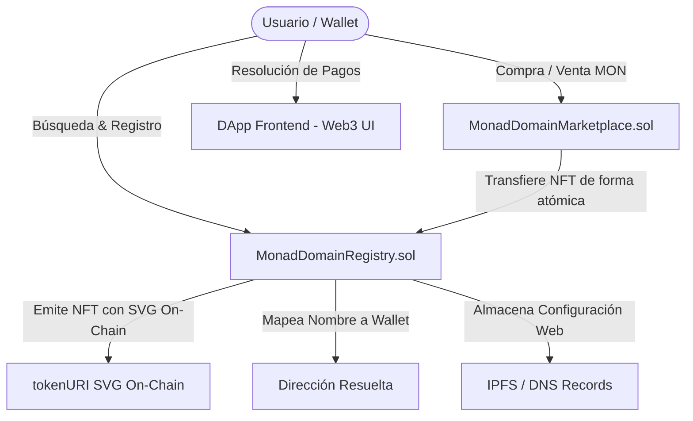

# <p align="center"></p>

<p align="center">
  <strong>Protocolo Descentralizado de Dominios Web3, Identidad On-Chain y Marketplace Nativo para la red Monad.</strong>
  <br>
  <em>Desarrollado, auditado, compilado y desplegado íntegramente desde un entorno móvil con <strong>Termux</strong> por <strong>kuromi04</strong>.</em>
</p>

<p align="center">
  <a href="https://kuromi04.github.io/monad-domain-marketplace/"></a>
  <a href="https://testnet.monadscan.com/"></a>
  <a href="https://termux.dev"></a>
  <a href="https://github.com/kuromi04"></a>
</p>

---

## ⚡ Descripción del Proyecto

**Monad Names (`.monad`)** es la infraestructura de nombres Web3 de última generación construida a la medida de los **10,000 TPS y finalidad instantánea de Monad**. 

A diferencia de los dominios tradicionales de la Web2 que dependen de servidores centralizados y tarifas anuales abusivas, los dominios `.monad` son **NFTs ERC-721 verdaderamente descentralizados**:

* 💳 **Sustituto de Direcciones Cripto:** Convierte direcciones hexadecimales largas (ej. `0x3750...61b4`) en nombres humanos memorables (ej. `kuromi04.monad`) para enviar y recibir MON y tokens.
* 🌐 **Web3 Site Builder & Hosting Descentralizado:** Vincula registros de IPFS, Arweave, GitHub Pages o servidores web directamente en la metadata on-chain de tu dominio.
* 💎 **Metadatos SVG 100% On-Chain:** El NFT genera su tarjeta artística visual dinámica en formato SVG codificado en Base64 sin depender de servidores externos o APIs de terceros.
* 🏪 **Marketplace Nativo Sin Custodia:** Compra, vende y realiza transferencias de dominios directamente en la blockchain de Monad mediante depósitos y contratos auditados con protección contra reentrancia.

<p align="center">
  
</p>

---

## 📱 Diseñado & Programado desde Termux por @kuromi04

Este repositorio es una prueba de ingeniería móvil avanzada: el ciclo completo de desarrollo —desde la escritura de smart contracts en Solidity, pruebas con Foundry, integración frontend y despliegue en la red de pruebas de Monad— se ejecutó íntegramente en un teléfono inteligente a través de la terminal **Termux**:

```bash
# Entorno de trabajo móvil
OS: Android Linux (aarch64)
Terminal: Termux
Tooling: Foundry (forge, cast), Node.js, Ethers.js v6, Git
Developer: @kuromi04
```

---

## 🚀 Acceso Rápido al DApp

| Canal | Enlace de Acceso |
| :--- | :--- |
| 🌐 **Aplicación Web Oficial** | [https://kuromi04.github.io/monad-domain-marketplace/](https://kuromi04.github.io/monad-domain-marketplace/) |
| 🦊 **MetaMask Mobile (Deep Link)** | [Abrir directamente en la app MetaMask](https://metamask.app.link/dapp/kuromi04.github.io/monad-domain-marketplace/) |
| 📦 **Explorador Monadscan** | [Ver Contrato Registry](https://testnet.monadscan.com/address/0x37502BC21D386eC8Eded562DD1626E767F1361b4) |

---

## 📍 Smart Contracts Desplegados y Verificados

Los contratos inteligentes están desplegados y operando en **Monad Testnet** (`Chain ID: 10143`):

| Smart Contract | Código Fuente | Dirección On-Chain | Funcionalidades Clave |
| :--- | :--- | :--- | :--- |
| **`MonadDomainRegistry`** | [`contracts/MonadDomainRegistry.sol`](./contracts/MonadDomainRegistry.sol) | [`0x37502BC21D386eC8Eded562DD1626E767F1361b4`](https://testnet.monadscan.com/address/0x37502BC21D386eC8Eded562DD1626E767F1361b4) | Registro ERC-721, SVG `tokenURI` on-chain, fijación de precios escalonados (3, 4 y 5+ caracteres), expiración, resolución inversa (`primaryDomain`) y almacenamiento descentralizado (`textRecords`). |
| **`MonadDomainMarketplace`** | [`contracts/MonadDomainMarketplace.sol`](./contracts/MonadDomainMarketplace.sol) | [`0x3A14D76195F6B8357F7e971dD7a9dDAAd89Cfb9D`](https://testnet.monadscan.com/address/0x3A14D76195F6B8357F7e971dD7a9dDAAd89Cfb9D) | Listado de dominios para venta secundaria, transferencias atómicas, pago instantáneo en MON y protección con `ReentrancyGuard`. |

---

## 🧩 Arquitectura del Sistema



---

## 💎 Precios Escalonados de Registro

Para proteger nombres escasos y evitar acaparamiento injusto, el protocolo implementa una escala tarifaria basada en la longitud del dominio:

* **3 letras (Nombres Ultra Raros, ej. `eth`, `btc`, `mon`):** `5.0 MON`
* **4 letras (Nombres Cortos, ej. `defi`, `game`, `meta`):** `2.0 MON`
* **5+ letras (Nombres Estándar y Marcas):** `0.5 MON`

---

## 🛠️ Stack Tecnológico

* **Smart Contracts:** Solidity `0.8.24`, OpenZeppelin Contracts (ERC721, ReentrancyGuard, Strings, Base64).
* **Entorno de Compilación & Testing:** Foundry (`forge build`, `forge test`).
* **Frontend Web3:** HTML5 Semántico, CSS3 moderno con modo claro/oscuro, Vanilla JavaScript con Ethers.js v6.
* **Integración Wallet:** EIP-6963 (Auto-detección de MetaMask, Rabby, Phantom, Brave, Coinbase) y WalletConnect v2 con código QR universal.
* **Hosting:** GitHub Pages con entrega continua.

---

## 💻 Instalación y Pruebas Locales

Si deseas clonar y auditar los contratos en tu propia máquina (o en tu propio dispositivo con Termux):

```bash
# 1. Clonar el repositorio
git clone https://github.com/kuromi04/monad-domain-marketplace.git
cd monad-domain-marketplace

# 2. Compilar con Foundry
forge build

# 3. Ejecutar suite de pruebas
forge test -vvv
```

---

## 👤 Autor

* **kuromi04** — Creador, desarrollador de Smart Contracts y Frontend.
* Repositorio: [https://github.com/kuromi04/monad-domain-marketplace](https://github.com/kuromi04/monad-domain-marketplace)

---

<p align="center">
  <sub>© 2026 Monad Name Service (.monad). Hecho con dedicación en Termux por kuromi04.</sub>
</p>
